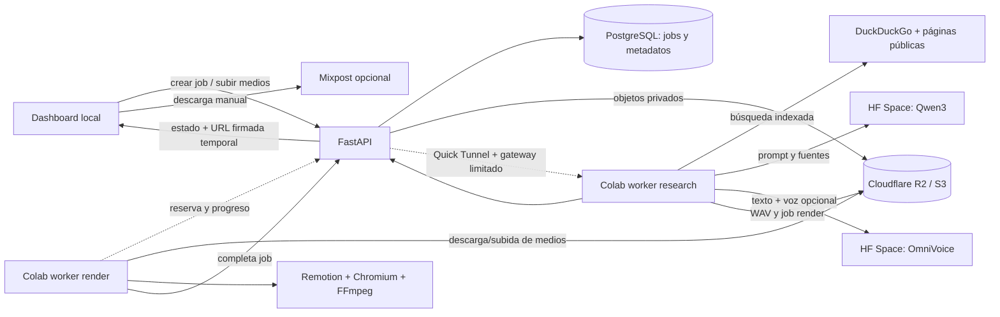

# Auditoría integral de Marketing Content OS

**Fecha:** 18 de octubre de 2026
**Alcance:** revisión estática del repositorio, documentación, configuración de Compose, notebooks y nombres de variables locales; seguimiento de correcciones funcionales en esta sesión.
**Resultado:** MVP local funcional en dashboard, API, PostgreSQL y almacenamiento privado R2. El flujo completo de generación con voz remota y MP4 todavía no está demostrado de extremo a extremo; quedan riesgos que deben resolverse antes de cualquier despliegue público.

> En esta sesión se ejecutó un ciclo real de API/PostgreSQL y upload/`HEAD`/descarga firmada de prueba en R2, con limpieza de datos temporales; pasaron 28 pruebas, el build Docker y checks HTTP locales. Los dos Spaces privados pasaron generación y TTS en CPU, con `USE_ZEROGPU=0`; el saldo de GPU quedó intacto. No se ejecutó Colab, clonación con voz propia ni render MP4: falta muestra autorizada para clonación y el secreto HF no está configurado en `.env`/Colab. Los valores secretos no se incluyeron en esta auditoría. El detalle está en [plan funcional y de cómputo](./plan-funcionalidad-y-computo.md).

### Estado de preparación y evidencia pendiente (actualización 18-oct-2026)

La actualización de polling/heartbeat de los notebooks y presencia de workers en dashboard está implementada en el commit previo `6ea4496`; las verificaciones locales de API/dashboard y de la ruta protegida quedaron registradas. **No hay todavía una sesión Colab conectada ni una corrida E2E.** Las pruebas aisladas de Qwen, TTS genérico y R2 no prueban por transitividad ni la integración del worker, ni clonación, ni la calidad del video.

| Capacidad solicitada | Situación demostrable hoy | Para considerarla funcional |
|---|---|---|
| Investigación de tendencias | Código de búsqueda web indexada y señales opcionales de YouTube | Procesar un trabajo desde Colab; evaluar frescura, enlaces y datos. DuckDuckGo no es escucha social en tiempo real ni confirma viralidad. |
| Guion | Space Qwen respondió en CPU en prueba directa | Validar contrato, fuentes/afirmaciones y guion en el mismo job iniciado desde dashboard. |
| TTS y clonación | TTS genérico probado en CPU; ruta zero-shot implementada | Enviar una muestra propia o autorizada, con transcripción exacta; escuchar y aceptar una narración real. |
| Render de video | Notebook y validaciones de salida implementados | Ejecutar Remotion en Colab, almacenar MP4 y revisar imagen, cortes, audio, subtítulos y sincronía. No hay MP4 aceptado actualmente. |
| Aprobación | El dashboard permite previsualizar/descargar y tiene enlace a Mixpost | Crear estado persistente pendiente/aprobado/rechazado y registrar actor/fecha/versión aprobada. El enlace actual a Mixpost no es aprobación registrada. |
| Publicación | Manual en Mixpost; Postiz no enlazado | Elegir integración, conectar OAuth/cuentas, resolver acceso seguro al MP4 privado, añadir idempotencia/estado y probar en entorno de prueba. No existe publicación automática al aprobar. |

Por tanto, el estado es **MVP parcial con componentes aislados verificados, no flujo automatizado completo**. El detalle secuencial y criterios de aceptación están en [el plan actualizado](./plan-funcionalidad-y-computo.md) y la máquina en [el manifiesto JSON](./estado-y-trazabilidad-marketing-content-os.json).

## Resumen ejecutivo

El sistema coordina una interfaz local con una API FastAPI y PostgreSQL. Dos notebooks de Google Colab actúan como workers: el primero investiga, solicita un guion a un Space de Qwen, genera voz mediante otro Space y encola el render; el segundo descarga los medios de R2 y produce el MP4 con Remotion. El dashboard permite revisar y descargar el resultado. Mixpost es una herramienta aparte para programación manual; el adaptador Publisher/Postiz está presente, pero no está conectado a ese flujo.

El repositorio tiene buena separación inicial por aplicaciones y un gateway de workers limitado a rutas concretas. Los riesgos más importantes son:

1. **Autenticación ausente en rutas de usuario de la API.** Los endpoints de alta/listado/consulta/subida y medios no verifican identidad. El túnel actual no los publica y Compose enlaza la API a loopback, pero exponerla detrás de un dominio daría acceso a datos y medios.
2. **Credenciales con alcance excesivo en Compose.** API y Publisher reciben el `.env` completo; la API no necesita claves de Postiz ni token HF para su función actual, y Publisher no necesita credenciales de base de datos, R2 o worker.
3. **Configuración del dashboard al compilar (corrección implementada).** Next.js incorpora `NEXT_PUBLIC_API_BASE_URL` durante `npm run build`; Dockerfile y Compose pasan el valor como argumento. Mantener el argumento correcto por entorno al construir una imagen para dominio.
4. **Render no totalmente reproducible ni sincronizado por palabra.** El notebook aún instala dependencias del sistema en cada runtime y ejecuta `npm install` sin lockfile. La duración del WAV dimensiona el MP4 y captions se reparten dentro de esa duración; todavía no se alinean con timestamps fonéticos.
5. **No hay evidencia de un ciclo de video completo ni aprobación/publicación integradas.** Guion Qwen y TTS genérico OmniVoice respondieron por CPU en sus Spaces privados sin descontar cuota GPU, y API/UI, PostgreSQL y R2 están validados. Queda conectar Colab, probar voz propia autorizada y MP4; además, no hay estado de aprobación persistente ni disparo automático a redes.

## Inventario y función real de componentes

| Ruta | Responsabilidad real | Estado/observación |
|---|---|---|
| `apps/dashboard` | UI Next.js: crea jobs, importa medios, consulta estado, muestra guion/audio/video | Activo en local; consulta API cada 10 s. No se conecta al servicio Publisher. |
| `apps/api` | FastAPI, cola PostgreSQL, reservas/leases, biblioteca y URLs firmadas | Orquestador principal. La cola vive en PostgreSQL; Redis no interviene en el flujo actual. |
| `apps/publisher-service` | Cliente HTTP de Postiz para listar integraciones y publicar | Servicio separado; se puede iniciar con perfil opt-in y no se integra con el dashboard. Sus endpoints no tienen autenticación de aplicación. |
| `apps/voice-studio-space` | Space Gradio basado en OmniVoice | La documentación previa indica síntesis de texto probada; clonación y uso desde Colab siguen pendientes. |
| `apps/script-generator-space` | Space Gradio con Qwen3-4B, salida editorial | El código carga modelo en ZeroGPU; el resultado depende del prompt del worker. El prompt de sistema del Space es general, no incorpora por sí mismo un framework de marketing. |
| `apps/hyperframes-space` | Interfaz Gradio de generación visual | **No implementado:** la función siempre devuelve error indicando backend no configurado. |
| `apps/open-gen-ai-space` | App de referencia/prototipo | No aparece como paso del pipeline activo ni como dependencia ejecutada. |
| `packages/python/core` | Esquemas Pydantic compartidos | Activo en API y pruebas. |
| `packages/python/adapters` | Adaptador local de cliente de voz | Existe, pero la llamada de voz principal del worker se hace en el notebook con `gradio_client`. |
| `packages/node/video-templates` | Espacio reservado para composiciones | El worker actual define la composición inline en el notebook; no consume este paquete. |
| `notebooks/01_research_scrapegraph.ipynb` | Worker de búsqueda, guion y audio | Requiere runtime Colab activo y Secrets configurados. |
| `notebooks/02_render_remotion.ipynb` | Worker de render | Construye un proyecto Remotion efímero dentro de `/content`. |
| `infra/docker-compose.yml` | PostgreSQL, API, dashboard, y servicios opt-in | Redis (`future-queue`), Publisher y Quick Tunnel son perfiles opcionales; Mixpost y sus dependencias también son opt-in. |
| `scripts/clone_third_party.py` | Clona repositorios externos a `third_party/` | Clones existentes se omiten; no fija commit ni actualiza. `third_party/*` está ignorado por Git. |

### Repositorios externos y dependencia efectiva

El script lista `marketingskills`, `hyperframes`, `VoiceStudio`, `Scrapegraph-ai`, `OpenMontage`, `Open-Generative-AI` y `remotion`. En el checkout visible existen clones locales de `Scrapegraph-ai` y `VoiceStudio`; el worker instala el fork de ScrapegraphAI fijado al commit `c75c8084fae2d4f5ba01a8c218bc1168b67e3569`, mientras que el despliegue del Space de voz empaqueta el clon local de VoiceStudio. Remotion se instala desde npm en Colab con versión directa `4.0.448`.

| Nombre en el clonador | Origen Git | Uso efectivo en este sistema |
|---|---|---|
| `marketingskills` | `https://github.com/javiertarazon/marketingskills.git` | Frameworks/prompts; no aparece como dependencia ejecutada. |
| `hyperframes` | `https://github.com/javiertarazon/hyperframes.git` | No conectado al pipeline; el Space local asociado es un stub. |
| `VoiceStudio` | `https://github.com/javiertarazon/VoiceStudio.git` | Fuente del módulo `omnivoice` empaquetado para el Space. Clon local observado en `286f46b`. |
| `Scrapegraph-ai` | `https://github.com/javiertarazon/Scrapegraph-ai.git` | El notebook instala el fork fijado al commit completo `c75c8084fae2d4f5ba01a8c218bc1168b67e3569`; clon local observado en `c75c808`. |
| `OpenMontage` | `https://github.com/javiertarazon/OpenMontage.git` | No aparece como dependencia ejecutada del flujo actual. |
| `Open-Generative-AI` | `https://github.com/javiertarazon/Open-Generative-AI.git` | No aparece como dependencia ejecutada del flujo actual. |
| `remotion` | `https://github.com/javiertarazon/remotion.git` | Clonador opcional; el worker instala paquetes npm (`remotion`, `@remotion/cli`) en Colab y no consume ese clon local. |

`marketingskills`, HyperFrames, OpenMontage y Open-Generative-AI no son dependencias activas del flujo observado. No se debe considerar que el código esté integrado solo porque el script pueda clonar los repositorios. En particular, el Space de Hyperframes es un stub y el paquete de plantillas Remotion no es consumido por el worker.

## Flujo de trabajo real

1. El usuario crea un trabajo `research`; la API valida el esquema y agrega referencias internas de assets seleccionados.
2. El worker de investigación reserva el trabajo con `WORKER_API_TOKEN`, obtiene un lease y reporta progreso. Busca páginas públicas indexadas por DuckDuckGo/ScrapeGraphAI y, si no logra extraer la página, puede usar un fragmento etiquetado.
3. El notebook envía las fuentes y el prompt editorial a Qwen. Después genera el audio usando VoiceStudio, carga el WAV a R2 y completa el trabajo.
4. La API crea transaccionalmente otro trabajo `render`, copiando petición, investigación, guion, referencia de audio y visual.
5. El worker de render descarga audio/visual, arma la composición Remotion, renderiza un MP4, lo sube a R2 y completa el trabajo.
6. El dashboard muestra cada job como fila independiente y obtiene audio/video por redirección a URL firmada de 5 minutos. La publicación final es manual en Mixpost. Publisher/Postiz no interviene.

**Actualización de workers (18-oct-2026):** la API registra heartbeats de sesiones Colab en `worker_instances`; el dashboard muestra investigación/voz y render como conectados, ocupados o desconectados. Los notebooks ahora hacen polling continuo cada 20 segundos y esperan trabajos nuevos. Colab sigue requiriendo iniciar cada notebook manualmente y no garantiza sesiones persistentes; el dashboard no puede arrancar ni reanimar una sesión de Colab gratuita. El túnel allowlisted ahora admite `POST /v1/workers/heartbeat`; `GET /v1/workers` permanece local.

## Hallazgos priorizados

### P1 — La API no autentica operaciones ni protege datos de jobs

`create_job`, `list_jobs`, `list_assets`, `upload_asset`, `get_job` y `get_job_media` no tienen dependencia de autenticación (ver `apps/api/main.py`, funciones alrededor de líneas 253–417). `serialize_job` incluye request/output/error; los endpoints de medios entregan una redirección firmada de audio/video. Las rutas del worker sí requieren token y lease, y el gateway actual solo enruta sus operaciones POST; esto limita la exposición del entorno local actual, pero no es suficiente para un despliegue con reverse proxy público.

**Impacto:** cualquiera que alcance la API podría crear trabajos, listar guiones/metadatos, importar archivos, obtener enlaces de medios y consumir cuota/capacidad. CORS no es autenticación.

**Acción:** antes de publicar la API, añadir autenticación de usuarios y autorización por propietario/tenant en todos los endpoints de datos; separar la API pública de creación/lectura de la interfaz privada del worker. Mantener el gateway con allowlist y límites de petición.

### P1 — Secretos de `.env` entregados a servicios que no los requieren

`api` y `publisher` usan `env_file: ../.env` (`infra/docker-compose.yml`). El `.env` reúne credenciales de PostgreSQL, worker, Hugging Face, S3, Postiz, redes sociales y Mixpost. El código del API usa DB, token worker y S3; Publisher usa Postiz y el host de almacenamiento configurado. No necesitan heredar todo el archivo.

**Impacto:** un fallo en cualquier servicio aumenta el conjunto de credenciales accesible. El publisher, por ejemplo, no necesita credenciales de DB ni token de worker.

**Acción:** dar a cada contenedor un conjunto explícito mínimo de variables/secrets. Separar secretos por entorno y rotar credenciales si alguna vez se incluyeron en imágenes, logs, notebooks compartidos o commits.

### Corregido — `NEXT_PUBLIC_API_BASE_URL` debe configurarse al compilar

Next.js incorpora `NEXT_PUBLIC_API_BASE_URL` al bundle durante `npm run build`. El Dockerfile y Compose ya pasan este valor como argumento de build.

**Seguimiento:** establecer el argumento correcto para cada entorno antes de construir la imagen. No es un valor de runtime que pueda cambiarse después de compilar.

### P1 — La relación de pipeline existe, pero falta aprobación persistente

La API ya relaciona el job de render con el job de investigación mediante `parent_job_id` y el dashboard presenta ambos dentro del pipeline. La relación no debe confundirse con un estado de aceptación editorial: el dashboard no guarda una decisión aprobada/rechazada ligada a una versión/hash del MP4. El enlace actual a Mixpost abre el flujo manual y no dispara publicación.

**Acción:** implementar estados de revisión persistentes y transición a publicación solo después de aprobación explícita; conservar historial, versión aprobada, autor/fecha y estado externo de publicación.

### P1 — Errores de worker pueden marcar un job fallido aun si falla el reporte

En ambos notebooks, el bloque `except` intenta llamar `/fail` y luego relanza. Si la llamada `/fail` falla por caída de red/token/lease, el estado local del worker no distingue fallo de procesamiento de fallo al reportar; el job puede seguir `running` hasta expirar el lease y repetirse.

**Impacto:** reintentos duplican llamadas pagadas a Spaces y renders. El heartbeat abandona su hilo ante un error de renovación, pero la función principal puede seguir ejecutando trabajo y terminar después de que la reserva expire.

**Acción:** cancelar el trabajo cuando la renovación falla, revisar lease antes de pasos costosos, aplicar idempotencia por etapa, hacer backoff por tipo de error y registrar estado de reporte por separado.

### P2 — Render no reproducible y cadena de dependencias cambiante

El notebook instala `nodejs`, `npm`, `ffmpeg` y `chromium` mediante `apt-get update`; crea un package manifest temporal e instala con `npm install` sin lockfile. Aunque las dependencias directas de Remotion tienen versión, la resolución transitiva y paquetes del sistema pueden cambiar.

**Impacto:** el mismo job puede producir builds distintos o dejar de arrancar entre sesiones de Colab. Las descargas/instalaciones se repiten al abrir un runtime nuevo.

**Acción:** empaquetar el worker de render en imagen/versionado o fijar imagen de runtime, versiones de Node/Chromium/FFmpeg, lockfile y checksum de artefactos. Reutilizar la composición de `packages/node/video-templates` en lugar de recrearla dentro del notebook.

### P2 — Duración, audio y subtítulos no se validan entre sí

La composición usa `ffprobe` para tomar la duración real del WAV al calcular frames; la versión actual también verifica H.264/AAC, 1080×1920 y duración del MP4 antes de guardarlo en R2. El diseño aplica overlay y zoom leve a visuales, captions en bloques cortos y salida CRF 18 con concurrencia limitada. El reparto de captions sigue siendo temporal aproximado: no es alineación palabra a palabra y puede mostrar texto adelantado/atrasado. El notebook instala herramientas del sistema en cada sesión y no tiene lockfile Node reproducible.

**Impacto:** un MP4 técnicamente válido puede ser un producto incompleto o poco usable.

**Acción:** obtener duración del audio con FFprobe, ajustar duración del vídeo a la narración/política seleccionada, generar subtítulos temporizados por voz (por ejemplo, alineación/ASR) y validar resolución, duración, audio y tamaño antes de subir/completar.

### P2 — Carga de medios limitada por memoria y procesamiento secuencial

El dashboard sube una carpeta archivo por archivo y se detiene al primero no compatible. La API lee el archivo subido vía `UploadFile`, pero no impone un límite en el servidor HTTP/proxy antes del parse multipart; el límite de 250 MB se valida tras recibirlo. No hay reanudación ni reintentos por archivo.

**Impacto:** carpetas grandes son lentas; una selección parcial deja archivos subidos antes del error; peticiones enormes pueden consumir recursos antes de responder 413.

**Acción:** límite de body en proxy/API, carga multipart/resumible a almacenamiento con URLs prefirmadas y registro posterior, validación del lote antes de transferir, hashes y reintentos por archivo.

### P2 — Publisher/Postiz es un camino no conectado y con supuestos incompatibles con R2 privado

El servicio permite publicar, pero el dashboard solo enlaza a Mixpost; el README confirma que la publicación se hace manualmente. El adaptador exige que `video_url` pertenezca al host HTTPS de `STORAGE_PUBLIC_BASE_URL`, mientras que el pipeline guarda medios en R2 privado y ofrece firmas temporales. No hay validación de que esa URL sea públicamente recuperable por Postiz.

**Impacto:** una configuración superficial de `POSTIZ_API_KEY` no garantiza publicación. Si el servicio se activa sin protección de red adecuada, `/v1/publish` no tiene autenticación de usuario.

**Acción:** escoger un único camino (Mixpost manual o Publisher/Postiz integrado), definir transferencia segura del MP4 privado y añadir autorización, auditoría e idempotencia antes de activar publicación automática.

### P2 — Protección de descarga de URLs de referencia necesita defensa en profundidad

El notebook valida el esquema HTTP(S), resuelve DNS y rechaza direcciones no globales; sigue redirects manualmente y limita su número. Es una protección positiva contra SSRF, pero la validación y la conexión HTTP resuelven DNS por separado, y la respuesta se lee sin un límite de bytes antes de extraer texto.

**Impacto:** un dominio con DNS cambiante o una página pública enorme puede eludir parte de los supuestos de seguridad/consumo.

**Acción:** limitar tamaño de respuesta en streaming, fijar resolución validada al conectar o usar egress proxy, restringir puertos y volver a validar cada redirect después de resolverlo.

### P3 — Documentación y estructura divergen

El README enlaza a auditorías previas con fecha 16–17 de octubre. La ruta `packages/node/video-templates` se describe como parte del sistema, pero el notebook crea otra composición inline. `apps/hyperframes-space` se presenta como módulo aunque siempre falla con mensaje de backend ausente. El repositorio Publisher/Postiz está en Compose, aunque no integra el flujo descrito por el README.

**Acción:** mantener una única matriz de “activo / opcional / prototipo / retirado”, actualizarla con cada cambio y evitar presentar stubs o repos clonables como capacidad implementada.

## Inventario de credenciales y alcance mínimo

Los nombres siguientes describen configuración, nunca se deben copiar sus valores a documentación o chat. No se verificó que los Secrets almacenados en Colab/Hugging Face sean correctos ni que los tokens remotos estén activos.

| Dónde | Variables | Para qué sirven | Alcance recomendado |
|---|---|---|---|
| API local | `DATABASE_URL` | PostgreSQL y persistencia de jobs/assets | Usuario DB dedicado, solo esquema de la app. |
| API + Colab | `WORKER_API_TOKEN` | Autentica operaciones worker; además se requiere lease por job | Token aleatorio largo, distinto por entorno; solo Colab worker secrets. |
| API + Colab | `S3_ENDPOINT_URL`, `S3_BUCKET`, `S3_ACCESS_KEY_ID`, `S3_SECRET_ACCESS_KEY` | Carga/descarga de assets, audio y MP4 en R2/S3 | Credencial S3 limitada a un bucket y a operaciones de objetos necesarias; bucket privado. La API y workers comparten cuenta actualmente. |
| Colab research | `API_BASE_URL` | URL HTTPS del API/gateway del túnel vigente | Solo URL pública; el Quick Tunnel cambia al reiniciar. |
| Colab research | `HF_TOKEN`, `SCRIPT_SPACE_URL`, `VOICE_STUDIO_URL` | Acceso de lectura a Spaces privados de Qwen y OmniVoice | Token HF de lectura limitado a los Spaces necesarios. No es credencial del API. |
| Administración Cloudflare | `CLOUDFLARE_API_TOKEN`, `CLOUDFLARE_ACCOUNT_ID`, `R2_BUCKET_NAME` en `.env.cloudflare.local` | Administración REST del bucket, no operaciones de runtime | Token separado, limitado a una cuenta/operación y duración necesarias. No pasarlo a contenedores/workers. |
| Mixpost opcional | `MIXPOST_APP_KEY`, `MIXPOST_DB_PASSWORD`, `MIXPOST_DB_ROOT_PASSWORD`, `MIXPOST_DB_NAME`, `MIXPOST_DB_USER`, `MIXPOST_URL`, `MIXPOST_DOMAIN` | Aplicación y DB aislada de Mixpost | Solo servicios de Mixpost. Las claves de redes/OAuth pertenecen al servicio/cuenta correspondiente. |
| Publisher/Postiz opcional | `POSTIZ_BASE_URL`, `POSTIZ_API_KEY`, `STORAGE_PUBLIC_BASE_URL` | Integraciones/publicación vía Postiz | Solo Publisher; añadir autenticación al endpoint antes de exponerlo. |
| Futuras integraciones | `YOUTUBE_CLIENT_ID`, `YOUTUBE_CLIENT_SECRET`, `TIKTOK_CLIENT_KEY`, `META_APP_ID`, `META_APP_SECRET` | Configuración de aplicaciones sociales | No son necesarias para el flujo activo de búsqueda; no habilitarlas hasta integrar OAuth con alcance mínimo. |

El `.env` local y `.env.cloudflare.local` existen y están ignorados por Git según `.gitignore`; el `git status` revisado estaba limpio y `git ls-files` no los incluye. En el `.env` local, al momento de esta lectura, estaban vacías las variables `HF_TOKEN`, `POSTIZ_API_KEY`, `YOUTUBE_CLIENT_ID`, `YOUTUBE_CLIENT_SECRET`, `TIKTOK_CLIENT_KEY`, `META_APP_ID` y `META_APP_SECRET`. HF se configura por separado en Secrets de Colab para el worker, según el README; ese secreto remoto no fue inspeccionado. Las siete variables vacías no impiden por sí mismas la API local de jobs, aunque sí indican que la publicación Postiz y OAuth no están listos en este entorno.

## Estado de validación conocido

La documentación histórica `docs/auditoria-marketing-content-os.md` registra validaciones del 16 de octubre. En la sesión del 18 de octubre se volvieron a ejecutar build Docker, suite de pruebas, checks HTTP, flujo API/PostgreSQL y transferencia firmada R2; consultar la matriz de pruebas del plan para los resultados y los límites de esta ejecución.

**Por lo tanto, la generación completa de un video no debe considerarse verificada todavía.** Un health check correcto o una salida de Space no valida el recorrido de job, lease, guion, WAV, R2, MP4, playback ni sincronización.

## Plan recomendado

### Antes de usar fuera de localhost

1. Añadir autenticación/autorización de usuario a API y Publisher; revisar CORS, límites de tasa y tamaño en el reverse proxy.
2. Reducir variables de entorno por servicio y separar secretos de workers/Spaces del `.env` de la API.
3. Resolver la configuración de API URL de dashboard en build/runtime y desplegar con dominio HTTPS fijo.
4. Mantener gateway de Colab en allowlist; rotar tokens si se pegaron en celdas compartidas, repositorio o registros.

### Antes de aceptar el video como final

1. Crear un `workflow_id` estable y registrar relación research → render.
2. Hacer heartbeat cancelable; introducir idempotencia y reintentos con backoff para llamadas a Qwen/OmniVoice/Remotion.
3. Fijar runtime/dependencias y reutilizar composición versionada con lockfile.
4. Medir duración del audio y validar MP4, códec, resolución, duración, tamaño y reproducción antes de marcar listo.
5. Ejecutar una prueba controlada de extremo a extremo: crear job, investigar, generar guion/voz, subir WAV, renderizar, subir MP4, reproducir/descargar y confirmar que fallos reportan estado visible.

### Para completar producto y mantenimiento

1. Elegir Mixpost manual o integración Publisher; no sostener dos rutas de publicación sin necesidad.
2. Etiquetar Hyperframes/Open-Gen-AI como prototipos o excluirlos del despliegue hasta tener backend funcional.
3. Definir retención y borrado para assets, logs y jobs; hoy no se ve un mecanismo de limpieza/expiración de objetos.
4. Añadir observabilidad con `workflow_id`, tiempos por etapa, costo/cuota, estado de dependencia y mensajes sin secretos.
5. Mantener SBOM/licencias y fijar versiones de imagen Docker: `cloudflare/cloudflared:latest`, `inovector/mixpost:latest` y `mysql/mysql-server:8.0` no ofrecen una referencia totalmente reproducible.

## Archivos principales revisados

- `README.md`
- `infra/docker-compose.yml`, `infra/worker-gateway.conf`
- `apps/api/main.py`, `packages/python/core/schemas.py`
- `apps/dashboard/app/page.tsx`, `apps/dashboard/Dockerfile`
- `apps/publisher-service/main.py`, `apps/publisher-service/adapters/postiz_adapter.py`
- `apps/script-generator-space/app.py`, `apps/hyperframes-space/app.py`, `apps/voice-studio-space/app.py`
- `notebooks/01_research_scrapegraph.ipynb`, `notebooks/02_render_remotion.ipynb`
- `scripts/clone_third_party.py`, scripts de despliegue HF, plantillas `.env.example`
