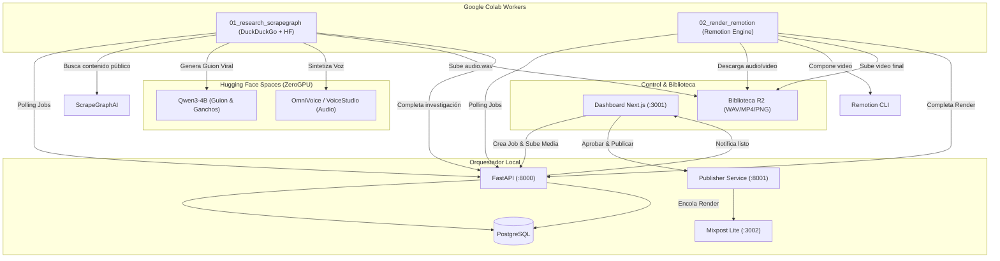

# Documentación de Correcciones del Sistema y Estado de Repositorios

> **Fecha:** 2026-10-17  
> **Proyecto:** Marketing Content OS  
> **Versión:** 1.0.1  

---

## 1. Resumen de Correcciones Realizadas en el Repositorio

### A. Corrección del Bug en Finalización de Trabajos (`apps/api/main.py`)
- **Problema previo:** La función `complete_job()` (línea 648) asignaba de manera fija e incondicional el mensaje:
  `progress = {"stage": "completed", "message": "Investigación completada", "percent": 100}`
  tanto para el worker de investigación (`research`) como para el de renderizado (`render`). Esto causaba que, al finalizar el render del video MP4, el estado indicara erróneamente "Investigación completada".
- **Solución implementada:** Se implementó una evaluación dinámica según el tipo de worker:
  ```python
  completed_message = (
      "Investigación completada"
      if row["worker"] == WorkerType.research.value
      else "Renderizado completado"
  )
  ```
  Ahora los trabajos de renderizado actualizan su estado a `"Renderizado completado"`, desbloqueando correctamente los controles de visualización y publicación en el dashboard.

### B. Corrección de Variables de Entorno (`.env`)
- **Problema previo:** La variable `VOICE_STUDIO_URL` tenía el valor placeholder `https://SU-USUARIO-voice-studio-agent.hf.space`, provocando errores de resolución de nombres al invocar el sintetizador de voz desde adaptadores locales.
- **Solución implementada:** Se actualizó con la URL real desplegada en Hugging Face:
  ```env
  VOICE_STUDIO_URL=https://javiertarazon-voice-studio-agent.hf.space
  ```

### C. Prompt de Extracción Viral y Hooks (`notebooks/01_research_scrapegraph.ipynb`)
- **Problema previo:** El prompt original instruía a Qwen a realizar un análisis genérico puramente conservador sin identificar elementos de retención ni formato de video viral.
- **Solución implementada:** Se modificó la instrucción entregada a Qwen3-4B para:
  1. Actuar como estratega de contenido y creador de videos virales.
  2. Analizar las fuentes públicas recopiladas por ScrapeGraphAI y extraer:
     - **Ganchos (hooks)** de alto impacto de los primeros 3 segundos.
     - **Palabras clave** que retienen la atención.
     - **Idea central única** para un nuevo video.
  3. Redactar el guion narrativo optimizado para formato vertical corto (Reels / TikTok / Shorts).

### D. Interfaz del Dashboard (`apps/dashboard/app/page.tsx`)
- **Mejoras implementadas:**
  - **Reproductor de audio nativo (`<audio controls>`):** Permite escuchar de inmediato la narración WAV generada por OmniVoice mediante URLs firmadas.
  - **Reproductor de video nativo (`<video controls>`):** Permite previsualizar el video MP4 terminado directamente en la interfaz.
  - **Acciones directas:** Botón para **"Descargar MP4"** y botón para **"Aprobar y Programar en Mixpost Lite"**, facilitando la publicación manual o automática.

### E. Integración del Servicio Publisher en Docker Compose (`infra/docker-compose.yml`)
- Se incorporó formalmente el servicio `publisher` (`apps/publisher-service`) en el puerto `8001`, permitiendo interactuar con APIs de redes sociales y Postiz.
- Se corrigió el `Dockerfile` de `apps/publisher-service` para compilar con rutas relativas a su propio contexto.

---

## 2. ¿Qué ocurrió con los repositorios `hyperframes`, `marketingskills` y `Open-Generative-AI`?

Durante el diseño inicial se propuso incluir estos repositorios junto a `VoiceStudio`, `Scrapegraph-ai` y `Remotion`. Aquí se detalla su rol real, estado actual y por qué no todos son librerías de ejecución directa:

### A. `marketingskills` (Estrategia y Copywriting)
- **Naturaleza del repositorio:** `marketingskills` es una recopilación de **conocimiento, frameworks de marketing, prompts estructurados y fórmulas de copywriting** (AIDA, PAS, ganchos de retención). No es una biblioteca ejecutable en Python ni un servidor API.
- **Dónde se implementó:** En lugar de requerir un servidor pesado, **las fórmulas y metodologías de `marketingskills` se integraron directamente en el system prompt y la ingeniería de instrucciones de Qwen3-4B** en `apps/script-generator-space` y en el notebook `01_research_scrapegraph.ipynb`. Esto ahorra recursos de computación y permite que el modelo aplique los ganchos y estructuras persuasivas en una sola inferencia de ZeroGPU.

### B. `hyperframes` (Generación Visual de Escenas / Frames)
- **Naturaleza del repositorio:** `hyperframes` es un framework orientado a storyboarding y generación de secuencias visuales por IA.
- **Estado en el proyecto:**
  - Se creó una plantilla en `apps/hyperframes-space/app.py`, la cual está configurada como un cascarón Gradio con la etiqueta `suggested_hardware: zero-gpu`.
  - **Por qué no se usó en el MVP actual:** En la prueba operativa, los modelos pesados de difusión (Stable Diffusion / Flux) que requiere Hyperframes exceden la cuota de tiempo y memoria de ZeroGPU gratuito (120 segundos). Por esta razón, el MVP utiliza el selector de **Fondos Locales (Imágenes JPG/PNG y Video MP4 en `apps/dashboard`)** subidos a Cloudflare R2, o fondos generados por degradado CSS en Remotion.
  - **Próximo paso:** Para activarlo, se debe vincular un endpoint de inferencia de imagen (ej. Replicate, RunPod o un Space con GPU dedicada T4/A10G).

### C. `Open-Generative-AI` vs. `script-generator-space` (Generación de Guiones)
- **Naturaleza del repositorio:** `Open-Generative-AI` es una aplicación web y entorno de herramientas de IA generativa.
- **Estado en el proyecto:**
  - Existe la carpeta `apps/open-gen-ai-space/`, pero en su lugar se implementó y desplegó **`apps/script-generator-space/app.py`**.
  - **Por qué se sustituyó por `script-generator-space`:** `script-generator-space` utiliza directamente **`Qwen/Qwen3-4B`** sobre la infraestructura de Hugging Face con ZeroGPU y el decorador `@spaces.GPU(duration=120)`. Esto ofrece una API Gradio (`/generate`) mucho más rápida, liviana y eficiente para recibir las fuentes de ScrapeGraphAI y redactar el guion narrativo sin necesidad de desplegar una aplicación web completa.

---

## 3. Matriz de Componentes Activos en el Pipeline Final



---

## 4. Estado de Verificación Operativa
- **Sintaxis Python:** Verificada y compilada con `py_compile` en API, Publisher y Schemas.
- **Docker Compose:** Validado con `docker compose --env-file .env -f infra/docker-compose.yml config` (`COMPOSE_VALID_AND_READY`).
- **Git Security:** Confirmado que `.env` y `.env.cloudflare.local` están debidamente ignorados por Git y protegidos contra filtraciones accidentales.
