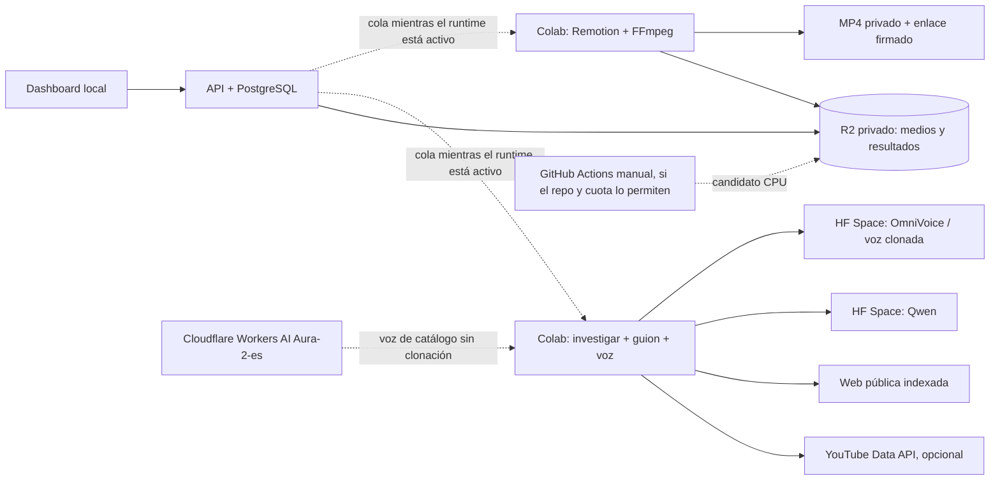

# Plan funcional y de cómputo para Marketing Content OS

**Fecha:** 18 de octubre de 2026
**Objetivo:** hacer confiable el recorrido desde investigación hasta MP4 con un PC de recursos modestos y sin GPU local, priorizando funcionalidad y pruebas reproducibles. La revisión y las correcciones de seguridad se ejecutan como etapa posterior, antes de publicar servicios.

## Estado real y definición de “listo” (actualización 18-oct-2026)

La base local y los servicios HF tienen pruebas aisladas documentadas: API/dashboard/PostgreSQL, operación S3/R2 temporal, guion Qwen CPU y TTS de catálogo OmniVoice CPU. La API registra workers y el dashboard muestra presencia; los notebooks tienen polling continuo mientras Colab está iniciado. **No se ha completado una tarea real de Colab, no se ha validado clonación con muestra autorizada, no existe MP4 final inspeccionado y no se ha implementado aprobación persistente con publicación automática.** No reportar “100% funcional” ni inferir calidad de video a partir de configuración o de un WAV corto.

### Puertas de aceptación en orden

| Puerta | Acción | Evidencia de aceptación |
|---|---|---|
| 1. Conectividad de workers | Arrancar la API/túnel local, configurar en Colab Secrets URL HTTPS vigente, `WORKER_API_TOKEN`, `HF_TOKEN` de lectura y S3/R2; iniciar ambos notebooks. | Ambos workers visibles como conectados, heartbeat renovado y reserva/finalización de un job de prueba. No escribir valores de secretos en el repositorio/logs. |
| 2. Investigación y guion | Crear desde el dashboard un tema acotado; ejecutar búsqueda y Qwen mediante el worker conectado. | Job conserva fuentes/URL/fecha y resultados por plataforma; guion estructurado, revisable y sin presentar inferencias como hechos. |
| 3. Voz genérica | Generar texto breve primero y un guion normal después con OmniVoice CPU. | WAV guardado en R2, sample rate/duración medidos, reproducción inteligible; tiempo y errores visibles en job. |
| 4. Clonación autorizada | Repetir con audio de voz propia o con permiso y transcripción exacta; comparar con TTS genérico. | Voz escuchada y aprobada por el usuario; guardar solo metadatos mínimos y no publicar la muestra de referencia. |
| 5. Video | Ejecutar worker Remotion, obtener MP4 desde R2 y reproducirlo de principio a fin. | Validar resolución vertical, fps, H.264/AAC, duración frente al WAV, tamaño, sincronía de segmentos, legibilidad de captions, composición y nivel/clipping de audio. Anotar defectos subjetivos y corregirlos; parámetros declarados no sustituyen inspección. |
| 6. Revisión humana | Añadir estados persistentes pendiente/aprobado/rechazado al artefacto exacto (versión/hash); el dashboard debe impedir publicación antes de aprobar. | Decisión, fecha/usuario, comentarios y versión revisada trazables; rechazar evita publicación. Actualmente el botón/enlace a Mixpost solo abre el servicio. |
| 7. Publicación | Elegir Mixpost o Postiz; completar OAuth de una cuenta de prueba y el mecanismo de transferencia del MP4 privado. | Publicación de prueba, ID/URL remotos, estado/error e idempotencia. Esto requiere credenciales y puede requerir dominio HTTPS estable. No se hace automáticamente en el estado actual. |

El hito “video para aprobación” queda alcanzado solo tras puertas 1–5 y revisión del MP4. “Aprobado y publicado” requiere además puertas 6–7. Colab gratuito no puede ser iniciado ni mantenido automáticamente por la app local: el worker toma trabajos automáticamente solo mientras la sesión manual siga conectada.

## 1. Decisión de arquitectura

Mantener el PC como plano de control liviano (dashboard, API y PostgreSQL), guardar medios en R2 privado y ejecutar cómputo en Colab gratuito cuando las sesiones estén activas. Los notebooks mantienen polling continuo y el dashboard muestra su presencia; cada runtime debe iniciarse manualmente y puede desconectarse. No tratar Colab ni un Space gratuito como servidores permanentes. Los Spaces ZeroGPU mantienen el hardware actual, pero usan CPU con dos hilos por defecto y no llaman `@spaces.GPU`; esto preserva el saldo diario. La CPU será lenta, especialmente para OmniVoice. `USE_ZEROGPU=1` es el opt-in explícito si se necesita acelerar y se acepta consumir cuota.

Los notebooks ahora reclaman trabajos en un ciclo continuo, reportan heartbeat incluso cuando esperan y actualizan estado/etapa. PostgreSQL conserva la cola y reencola leases expirados. El usuario ejecuta cada notebook una vez por sesión y deja la celda final activa; si Colab desconecta el runtime, el estado pasa a desconectado y hay que iniciarlo de nuevo. Esta automatización no puede iniciar sesiones gratuitas de Colab desde el dashboard.

## 2. Correcciones funcionales implementadas en esta revisión

| Área | Corrección | Efecto esperado |
|---|---|---|
| Despliegue del dashboard | `NEXT_PUBLIC_API_BASE_URL` se declara como `ARG` de build y Compose lo pasa en `build.args`. | La URL pública configurada se incorpora durante `next build`, en lugar de depender de una variable runtime tardía. |
| Identidad de pipeline | `jobs.parent_job_id`, migración idempotente, índice y serialización del parent; al completar investigación se crea el render con el id de investigación. | Dashboard puede agrupar investigación y render bajo un mismo pipeline. |
| Configuración de voz | Esquema y formulario incluyen `voice_gender`, `voice_age`, `voice_pitch`, que se pasan a OmniVoice. | Las opciones de diseño de voz del worker llegan desde el usuario hasta el modelo. |
| Duración/calidad de video | Render consulta la duración del WAV generado; la plantilla agrega overlay, zoom lento, captions en bloques cortos, progreso y marca. FFprobe verifica H.264/AAC, 1080×1920 y duración antes de subir. x264 usa CRF 18, `veryfast` y dos hilos. | Evita MP4 incompleto o con códec/tamaño incorrecto. Los captions siguen siendo aproximados, no alineación palabra por palabra. La calidad visual final aún requiere inspección de un render real. |
| Reserva de trabajos | Ambos notebooks verifican el lease y detectan pérdida en heartbeat antes de seguir con operaciones costosas. | Evita gastar inferencia/render y completar un trabajo cuya reserva ya pertenece a otro worker. |
| Scraping cuantitativo opcional | YouTube Data API puede buscar videos recientes del tema, recuperar vistas/fecha y calcular vistas por hora; si el secreto opcional no está creado, el notebook sigue con búsqueda web. | Añade una señal comparable para YouTube; no etiqueta una búsqueda limitada como ranking viral global. |
| Operación de Colab | Los notebooks consultan la cola continuamente mientras la sesión está activa; la API registra heartbeat/etapa/ID de job y el dashboard muestra investigación/voz y render conectados u offline. | Los trabajos del dashboard se procesan sin volver a ejecutar la celda por cada job. La sesión de Colab debe arrancarse manualmente y puede caducar. Redis y publisher permanecen opt-in. |
| Cobertura de pruebas | Se añadieron casos para opciones de voz, parent id del pipeline y el `INSERT` de render al completar investigación. | Captura contratos funcionales que antes no estaban protegidos. |
| Consumo ZeroGPU | Spaces usan CPU por defecto (OmniVoice CPU; Qwen3-1.7B CPU); reserva GPU solo con `USE_ZEROGPU=1`. | Evita agotar el saldo de 5 minutos por defecto; CPU puede tardar varios minutos por solicitud. Notebook espera 15 min por guion y 30 min por voz. |

Las correcciones no demuestran por sí solas el pipeline remoto. En esta sesión sí se recorrieron la API/PostgreSQL y la carga/descarga privada en R2; Spaces remotos, audio clonada y render deben probarse con los recursos y artefactos disponibles.

## 3. Pruebas: matriz y resultado real de esta sesión

| Módulo/caso | Prueba necesaria | Estado observado |
|---|---|---|
| Suite Python | `.venv/bin/python -m pytest -q` desde WSL | **27 pasaron**. Queda una advertencia de deprecación: Starlette TestClient usa `httpx`; instalar/migrar a `httpx2` cuando el stack lo soporte. |
| API y pipeline | Crear job, reservar, reportar progreso, completar investigación, enlazar render por parent, reservar render y registrar fallo | **Smoke real contra API y PostgreSQL pasó**; eliminó los jobs temporales. Se corrigieron dos placeholders SQL sin tipo que provocaban 500 en completar/fallar. |
| Dashboard | Build Docker de producción y HTTP local | **`next build` y chequeo TypeScript pasaron dentro de Docker; `http://localhost:3001` respondió 200.** |
| Compose | `docker compose --env-file .env -f infra/docker-compose.yml config --quiet` | **Correcto**: Compose pudo resolver la configuración y variables sin imprimir secretos. |
| Contenedores, PostgreSQL y migración | `docker compose up --build -d`, healthcheck y acceso funcional | **API, dashboard y PostgreSQL están arriba; PostgreSQL healthy y `/healthz` respondió `{"status":"ok"}`.** |
| Investigación web | Job real sin YouTube API; confirmar fuente, enlace, fecha y señal | No ejecutado; requiere worker Colab, túnel y credenciales configuradas. La búsqueda DDG es cobertura indexada, no un scraper general de cada red. |
| Métricas YouTube | Job con `YOUTUBE_API_KEY`; inspeccionar fecha, vistas y vistas/hora | No ejecutado: solo está documentado el nombre opcional del secreto; no se leyó ni expuso valor alguno. |
| Guion | Solicitud real al Space de Qwen y validación de JSON/estructura, duración, fuentes y CTA | **CPU pasó:** Qwen3-1.7B respetó ambas secciones del contrato en 19 s después de calentar el Space. |
| TTS de catálogo | Texto real con diseños femenino/masculino y comprobar WAV, sample rate, duración y claridad | **CPU pasó:** OmniVoice devolvió WAV mono 24 kHz, 3.48 s y 167 KB en 39 s; archivo temporal borrado. |
| Almacenamiento privado R2 | Subir archivo de prueba, verificar `HEAD`, descarga con URL firmada y limpiar | **Pasó usando el endpoint configurado; objeto y metadatos temporales eliminados.** |
| Clonación autorizada | WAV propio + transcripción exacta + permiso; comprobar audio generado y A/B | Pendiente: no hay WAV de referencia disponible y `HF_TOKEN` no está configurado localmente; no se envió contenido de voz a servicios remotos. |
| Spaces Hugging Face | Desplegar, revisar privacidad/hardware/runtime y ejecutar inferencia de guion y TTS | CPU verificado en commits `c73badf2` (Qwen3-1.7B) y `d8f6bee5` (OmniVoice), ambos privados y `RUNNING` en `zero-a10g`; `USE_ZEROGPU=0` en ambos. El saldo permaneció **265.637/300 GPU-s** antes y después de las pruebas CPU. Se dejó un marcador decorado de 1 s que no se invoca, requisito de arranque ZeroGPU. |
| Render Remotion | Audio + visual opcional, render MP4, validar duración, resolución, fps, audio y subtítulos | No ejecutado: requiere worker Colab, audio de entrada y sus dependencias de sistema. |
| Pipeline completo | Investigación → guion → voz → render → carga/descarga del MP4 | No se puede certificar hasta que todos los pasos anteriores pasen en el entorno real. |

Comprobaciones realizadas previamente: build Next.js Docker; API/PostgreSQL real; transferencia R2; checks HTTP. En esta ronda pasaron tests estáticos del notebook/Spaces CPU (3 tests al subset), `py_compile`, `bash -n`, y el smoke real script→voz CPU. **28 pruebas Python pasaron** antes de los últimos cambios del smoke/parser; la suite completa se repite al finalizar. La cuota HF se mantuvo exactamente en 265.637/300 GPU-s tras las inferencias CPU. **No se declara completo el e2e ni la calidad visual sin clonación con muestra autorizada, ejecución Colab y render MP4 inspeccionable.**

### Requisitos concretos para una corrida integral

1. Iniciar Docker Desktop en modo Linux y comprobar `docker info`; WSL debe abrir sin `Wsl/E_ACCESSDENIED`.
2. Configurar en `.env` los secretos locales y R2 requeridos. En esta sesión `HF_TOKEN` está vacío en `.env`; el token OAuth del CLI solo está en WSL y Colab no puede acceder a esa caché. Agregar manualmente un token HF de lectura a Colab Secrets con acceso a ambos Spaces privados.
3. Subir a la Biblioteca una muestra WAV propia, limpia, con una sola voz, y transcripción literal. Usar solo voz propia o autorizada.
4. Configurar ambos notebooks en Colab Secrets. Activar `YOUTUBE_API_KEY` solo si se quiere probar métricas; los demás módulos no deben depender de ella.
5. Ejecutar un caso pequeño de extremo a extremo, luego repetir con clonación, voz de catálogo, visual propio, recuperación tras lease vencido y fallo de cada Space.
6. Guardar en el job su configuración, versiones de modelo, resolución, duraciones, fuentes y errores; evaluar la salida con checklist humano antes de llamarla lista para publicar.

## 4. GPU y costes con PC sin GPU

| Opción | Uso aconsejado | Límites/práctica |
|---|---|---|
| HF Spaces ZeroGPU | Inferencia CPU predeterminada de OmniVoice/Qwen; `USE_ZEROGPU=1` para aceleración opcional | Ruta CPU probada y no gastó cuota. La GPU compartida tiene cola y cuota diaria, así que se reserva para solicitudes urgentes o textos largos. Los Spaces permanecen privados y el worker usa token read-only. |
| Google Colab gratuito | Worker continuo de investigación/render mientras el runtime está activo | Los notebooks hacen polling y reportan presencia; el usuario inicia cada runtime manualmente. Las sesiones pueden desconectarse y no son servicio 24/7. |
| Kaggle Notebooks GPU | Alternativa manual de emergencia para comparar una inferencia/render | Cuota semanal y disponibilidad varían; hay que adaptar Secrets y acceso de red/R2 y validar que la API acepte las conexiones. No es un worker permanente. |
| Cloudflare Workers AI | TTS de catálogo en español (Aura-2-es) para voz estándar sin clonar | No ofrece la voz personalizada del usuario; requiere token de Workers AI separado. Se puede elegir como fallback y conservar OmniVoice para clonación/diseño. La tarifa publicada actualmente es por caracteres; revisar antes de activarlo. |
| GitHub Actions manual | Candidato para Remotion/FFmpeg en CPU y operación reproducible | El render no necesita CUDA. Validar Chromium, memoria, límites de minutos y acceso a R2. Mejor como workflow manual `workflow_dispatch` que como runner continuo; cuota depende de repo/plan. No enviar secretos a logs. |
| GPU alquilada bajo demanda | Solo si benchmarks muestran necesidad sostenida o colas HF inaceptables | RunPod/Vast/otros cobran por hora y almacenamiento; no se considera gratis. Apagar al terminar, usar imagen fijada, volumen mínimo y límite de gasto. |

**Recomendación:** mantener el modo CPU para uso gratuito normal; reservar ZeroGPU como opt-in. Probar primero un job de Remotion en CPU de Actions o Colab y medir minutos/video, memoria pico y tamaño. Probar TTS Aura para narración estándar si OmniVoice CPU resulta demasiado lento. Mantener la clonación autorizada en OmniVoice; el TTS de catálogo no sustituye una voz propia. No migrar a proveedor de GPU pago hasta comparar coste por minuto final, cold starts y calidad de audio.

## 5. Voz: mantener base y comparar candidato

- **OmniVoice / VoiceStudio (actual):** mantener como motor inicial. Está empacado en el Space actual, ya recibe texto y ahora recibe atributos de diseño. Probar por separado `voice_reference_asset_id` (voz clonada) frente a la voz generada por atributos; no inferir que clonación funciona porque el selector de catálogo sí sintetice.
- **Chatterbox Multilingual V3 (candidato):** evaluar en un Space temporal o notebook aislado con el mismo WAV autorizado y las mismas tres frases en español latino. El proyecto oficial declara clonación multilingüe e incluye español latino. El checkpoint específico es de varios GB y usa GPU; no hay evidencia aquí de que consuma menos o responda más rápido que OmniVoice. Cambiar solo con A/B documentado de similitud, naturalidad, acento, latencia, VRAM, licencia y estabilidad.
- **Cloudflare Aura-2-es (fallback de catálogo):** útil para voces listas en español sin GPU propia. No clona muestra de usuario; reservarlo para voz genérica, subtítulos/pruebas o contingencia.
- **No añadir modelos duplicados aún:** varios modelos elevan cold start, peso de Space y mantenimiento de dependencias. Benchmark uniforme antes de integrar.

**Set mínimo de aceptación TTS:** 3 textos (corto, 30–45 s y números/nombres), WAV legible, duración coherente, idioma/acento entendible, pausas y pronunciación revisadas, ruido/clipping revisados, repetición idéntica en parámetros, clonación comparada ciega y latencia p50/p95 medida. Los resultados deben guardar modelo/commit, referencia sin publicar y hash, transcripción autorizada y métrica, no el secreto/token.

## 6. Tendencias y scraping legítimo/medible

1. **YouTube:** la API opcional aplicada busca videos de los últimos 14 días para el término y ordena por vistas; obtiene fecha/vistas y estima vistas/hora. Es señal relativa al tema/consulta, afectada por búsqueda, tamaño del canal y edad del video. Para popularidad regional/categoría se puede añadir `videos.list(chart=mostPopular, regionCode=...)`; esto es otra señal y no demuestra que un hook sea viral.
2. **TikTok:** usar Creative Center como fuente de tendencias agregadas por región/industria y registrar la fecha de consulta. No automatizar endpoints privados ni evadir límites. En esta fase puede ser una fuente manual revisada por persona.
3. **Reddit:** si se integra API oficial, comparar `hot`/`top` por comunidad/ventana y registrar score, comentarios, fecha. Los resultados actuales del buscador no son volumen de engagement.
4. **Instagram, Facebook y X:** usar APIs oficiales si los permisos y tipos de cuenta lo permiten, o análisis manual de fuentes públicas autorizadas. No prometer un scraper universal de feeds protegidos.
5. **Clasificador editorial:** separar observación (`views/hour`, fecha, fuente) de inferencia (tema acelerándose) y de propuesta (hook original). Nunca copiar la frase exacta, guion o identidad de otra cuenta. Mostrar cobertura y edad de la señal.

La respuesta UI debe exponer `source_type`, URL, fecha de publicación/lectura, views, views/hour y advertencia de cobertura. Sin métricas, decir “coincidencia encontrada en búsqueda pública”; no usar “viral” como hecho.

## 7. Guion y edición

- El módulo de guion debe producir un contrato JSON validado (gancho original, beats, narración, fuentes, afirmaciones y CTA). Si una fuente no respalda una afirmación, marcarla para revisión en vez de inventar cifras.
- Validar texto final y duración objetivo con estimación por palabras/ritmo español; no cortar el texto solo para caber en un tiempo arbitrario. Reintentar con un solo formato de reparación y conservar error bruto para diagnóstico.
- En video, usar duración real de WAV y captions sincronizados por segmentos o timestamps del alineador. La división uniforme de guion sirve como placeholder, pero no es sincronización fonética.
- Extraer la composición Remotion de la celda a `packages/node/video-templates`; fijar Node, paquetes, Chromium y ffmpeg, instalar con lockfile. Reutilizar overlays/config declarativa; limitar resolución/fps al preset seleccionado y permitir 720×1280 como perfil liviano de prueba.
- Validar MP4 resultante con `ffprobe`: codec H.264/AAC compatible con la red elegida, resolución vertical, fps, audio presente, duración dentro de tolerancia del WAV y tamaño máximo. Preview y aprobación manual antes de publicar.
- Guardar resultados de intermediarios en R2 por claves inmutables asociadas a job/pipeline; evitar descargar y renderizar dos veces al reintentar solo la última etapa.

## 8. Secuencia de ejecución

### Fase A — cerrar funcionalidad local

1. Ejecutar typecheck/build dashboard, pruebas unitarias y sintaxis notebook.
2. Iniciar Docker+PostgreSQL; verificar migración desde una base vacía y desde una base anterior sin `parent_job_id`.
3. Validar creación, reserva, heartbeat, vencimiento/reintento, finalización y agrupación pipeline en API/dashboard.
4. Documentar variables de cada servicio y retirar workers/servicios que no se usan por defecto.

### Fase B — validación de integración remota

1. Un job con búsqueda web sin claves sociales.
2. Un job con métricas YouTube API opcionales y comparación de ventanas/region.
3. Guion real contra Space Qwen con salida JSON válida y referencias rastreables.
4. TTS de catálogo de OmniVoice, luego clonación autorizada; después voz Cloudflare como fallback si se decide.
5. Render con audio y sin visual propio; render con un video propio y captions. Medir duración/códec/latencia.
6. Repetir con Space inactivo, túnel que cambia, pérdida de lease, fallo R2 y reintento para comprobar recuperación sin duplicar artefactos.

### Fase C — optimización según benchmark

1. Medir cold start, tiempo de inferencia, duración de audio/minutos de GPU y fallos/cuota por proveedor.
2. Medir render CPU/RAM en Colab y workflow manual de Actions.
3. Comparar OmniVoice con Chatterbox solo con la misma referencia, contenido y hardware/cuota equivalente.
4. Seleccionar modelo/proveedor por calidad, coste por pieza, disponibilidad y tiempo total, no por nombre del repositorio.
5. Cachear entornos/modelos cuando la plataforma lo permita, pin de commits, dependencias y assets, e instrumentar fallos/coste.

### Fase D — seguridad tras la aceptación funcional y antes de producción

Conservar como backlog: autenticación/propiedad en API, secretos mínimos por servicio, token Cloudflare separado, cuotas y límites de carga, validar URLs contra SSRF, CORS de producción, archivos/tamaños, acceso privado a medios, logs y rotación de credenciales, auth del publisher, revisión de exposición del túnel y dependencias fijadas. El gateway actual protege operaciones de workers; no convierte las rutas de usuario de la API en autenticadas. No publicar el API hasta completar esta fase.

## 9. Referencias oficiales para límites y modelos

- [Hugging Face Spaces ZeroGPU](https://huggingface.co/docs/hub/main/spaces-zerogpu): cuotas, cola, límites de uso y recomendaciones de carga de modelos.
- [Google Colab FAQ](https://research.google.com/colaboratory/faq.html?authuser=0&hl=en): recursos dinámicos, cortes de runtime y restricciones del nivel gratuito.
- [Kaggle Efficient GPU Usage](https://www.kaggle.com/docs/efficient-gpu-usage): uso interactivo de GPU y cuota semanal publicada.
- [GitHub Actions: precios](https://docs.github.com/en/billing/concepts/product-billing/github-actions) y [ejecución manual de workflows](https://docs.github.com/en/actions/how-tos/manage-workflow-runs/manually-run-a-workflow).
- [YouTube API: cuota](https://developers.google.com/youtube/v3/determine_quota_cost?hl=en) y [videos.list](https://developers.google.com/youtube/v3/docs/videos/list?hl=en).
- [TikTok Creative Center: Trends](https://ads.tiktok.com/resources/help/article/how-to-use-trends?redirected=2).
- [OmniVoice/VoiceStudio](https://github.com/k2-fsa/OmniVoice) y [Chatterbox](https://github.com/resemble-ai/chatterbox); probar licencias/weights y rendimiento de cada checkpoint antes de redistribuir.
- [Cloudflare Aura-2-es](https://developers.cloudflare.com/workers-ai/models/aura-2-es/) y [Workers AI pricing](https://developers.cloudflare.com/workers-ai/platform/pricing/).
